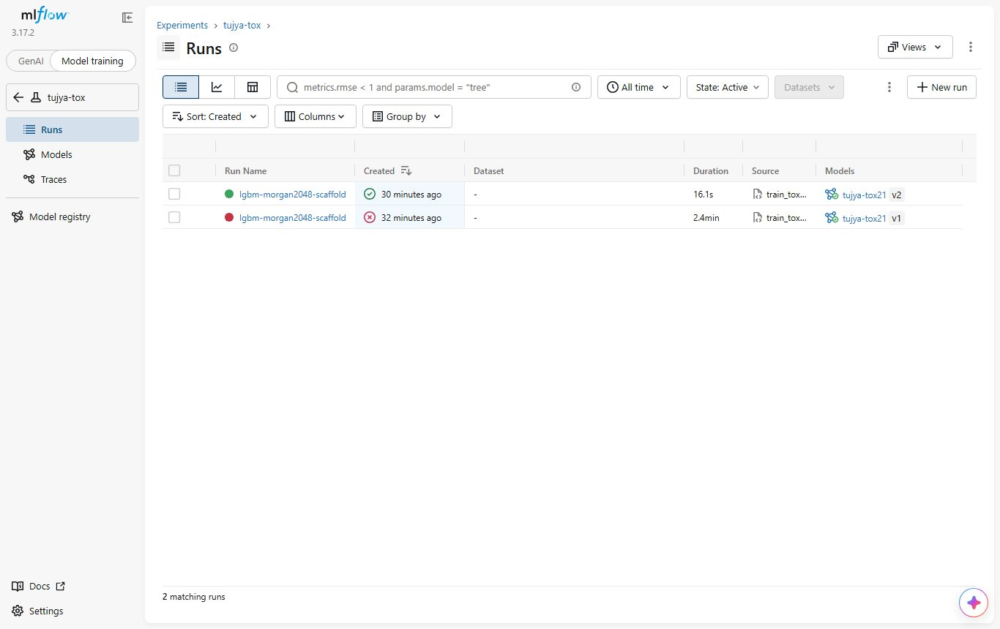
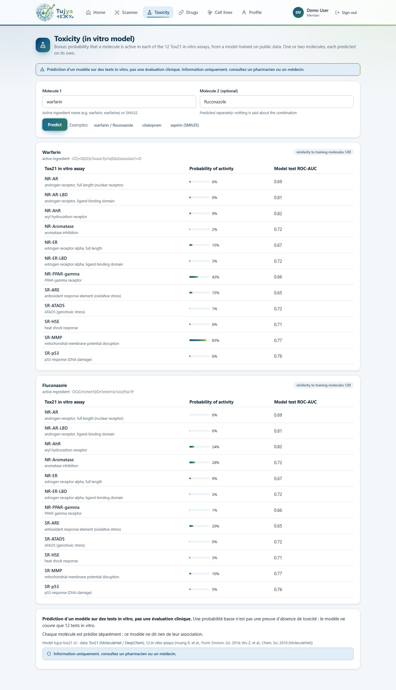

# Bonus: single-molecule toxicity tool (Tox21)

`predict_toxicity` gives, for one or two molecules (an active ingredient name or a SMILES),
the probability that each molecule is **active** in the 12 Tox21 in vitro assays. Every
output says it is a **"prédiction d'un modèle sur des tests in vitro, pas une évaluation
clinique"**. Each molecule is predicted on its own: the tool never says anything about a
mixture. Decisions: D73 (data and licence) and D74 (design and safety) in docs/DECISIONS.md.

> Information uniquement, consultez un pharmacien ou un médecin.

## Data and licence

| | |
|---|---|
| Dataset | Tox21, MoleculeNet copy: `tox21.csv.gz` from DeepChem (<https://deepchemdata.s3-us-west-1.amazonaws.com/datasets/tox21.csv.gz>), 7,831 molecules, 12 binary tasks with missing labels |
| Origin | Tox21 Data Challenge 2014 (NIH NCATS, with NIEHS/NTP, EPA and FDA), <https://tripod.nih.gov/tox21/challenge/> |
| Licence | **No explicit licence file was found** for the MoleculeNet copy or on the challenge page (checked 2026-10-28). The data were produced by US federal agencies and released publicly at no cost; DeepChem's code is MIT, which does not cover the data. Treated as public research data: cited, used for this non-commercial student project, **not redistributed** (DVC only, never in git) (D73) |
| Citation | Huang R. et al., "Tox21 Challenge to Build Predictive Models of Nuclear Receptor and Stress Response Pathways as Mediated by Exposure to Environmental Chemicals and Drugs", Front. Environ. Sci. 2016; Wu Z. et al., "MoleculeNet: a benchmark for molecular machine learning", Chem. Sci. 2018 |
| Versioning | `data/tox21/` (the file + `SOURCE.json`: URL, SHA-256 `45d09792…`, size, date) with `dvc add`, pushed to the DVC remote |
| Ingredient structures | `config/ingredient_smiles.csv`: one PubChem SMILES per active ingredient (82/82), by `backend/scripts/fetch_ingredient_smiles.py`; PubChem is public domain. Aliases: valproate -> valproic acid, vitamin B12 -> cyanocobalamin, vitamin B6 -> pyridoxine |

The 12 assays: NR-AR, NR-AR-LBD (androgen receptor), NR-AhR (aryl hydrocarbon receptor),
NR-Aromatase, NR-ER, NR-ER-LBD (estrogen receptor alpha), NR-PPAR-gamma, SR-ARE (oxidative
stress), SR-ATAD5 (genotoxic stress), SR-HSE (heat shock), SR-MMP (mitochondrial membrane
potential), SR-p53 (DNA damage).

## Model

`backend/scripts/train_tox21.py` (backend venv: RDKit 2026.09, LightGBM 4.7, MLflow):

- **Features** (`backend/app/toxicity.py`, shared with the API): largest fragment (salts
  removed), Morgan fingerprint radius 2, 2,048 bits. 7,823 of 7,831 molecules parse.
- **Scaffold split** (Bemis-Murcko, largest scaffold groups first into train, as
  MoleculeNet / DeepChem): 6,258 train / 782 validation / 783 test, 2,285 scaffolds. Test
  molecules have scaffolds never seen in training, which is harder than a random split.
- **One LightGBM model per task** (molecules without a label for that task are skipped):
  learning rate 0.05, 31 leaves, feature fraction 0.3, bagging 0.8, L2 1.0, up to 2,000
  rounds with early stopping (100) on validation ROC-AUC. Training: 77 s on the laptop CPU.

| Task | Test molecules (active) | Valid ROC-AUC | **Test ROC-AUC** | Train ROC-AUC |
|---|---:|---:|---:|---:|
| NR-AR | 713 (27) | 0.800 | **0.694** | 1.000 |
| NR-AR-LBD | 621 (20) | 0.864 | **0.813** | 0.999 |
| NR-AhR | 624 (89) | 0.804 | **0.822** | 0.975 |
| NR-Aromatase | 522 (47) | 0.748 | **0.716** | 0.967 |
| NR-ER | 554 (68) | 0.669 | **0.672** | 0.861 |
| NR-ER-LBD | 651 (22) | 0.820 | **0.721** | 0.960 |
| NR-PPAR-gamma | 571 (23) | 0.758 | **0.658** | 0.975 |
| SR-ARE | 476 (116) | 0.758 | **0.647** | 0.943 |
| SR-ATAD5 | 669 (34) | 0.731 | **0.720** | 0.998 |
| SR-HSE | 572 (46) | 0.714 | **0.709** | 0.987 |
| SR-MMP | 518 (99) | 0.797 | **0.772** | 0.975 |
| SR-p53 | 628 (73) | 0.725 | **0.759** | 0.984 |
| **Mean** | | **0.766** | **0.725** | |

Reading: ranking actives above inactives works moderately (0.65 to 0.82), with few actives
per task in the test set (20 to 116), so each AUC is uncertain; train AUC near 1.0 shows
strong overfitting. No other model or published result was compared on this exact split,
so no claim is made against the literature. The probabilities are not calibrated.

MLflow: experiment **`tujya-tox`**, run `lgbm-morgan2048-scaffold`
(`6d3e6790ae444d04b8b4edac32dda19c`): parameters, data URL and SHA-256, split sizes,
per-task validation and test ROC-AUC, the bundle; registered model **`tujya-tox21`**
version **2** (pyfunc: SMILES column -> one probability per task). Version 1 is an identical
first run whose script crashed after registering (a Windows console encoding error in an
MLflow log line); its run is marked FAILED with a note. `python scripts/train_tox21.py
publish` copies the registered bundle to `models/tox21/` (git-ignored), which the API loads.



**Applicability domain** (heuristic): the highest Tanimoto similarity between the query
and the 6,258 training fingerprints; below 0.3 the result says the molecule is far from the
training molecules. Of the 82 Tujya ingredients, 49 have an identical fingerprint in the
training set (for those the model mostly reflects measured labels), 4 are below 0.3
(citalopram, mycophenolate mofetil, tiagabine, vitamin B12).

## Where it is used

| Place | What |
|---|---|
| Agent tool (`app/rag/tools.py`) | `predict_toxicity(molecules)`, in `CHAT_TOOLS`; the planner may call it; the graph adds it by rule when the question talks about toxicity / Tox21 / in vitro |
| MCP server | fifth tool `predict_toxicity`; the server instructions repeat the wording and "never conclude about a mixture" |
| API | `POST /api/toxicity` `{"molecules": ["warfarin", "fluconazole"]}` (1 or 2, sign-in required): per molecule the 12 probabilities, the test ROC-AUC of each task, the similarity to the training set, plus `wording`, `mixture_note`, `low_probability_note`, model version, source, disclaimer; 503 without a published model |
| Web | page **Toxicity** (menu): one or two molecules, one card per molecule, the wording and the disclaimer always visible |



## Safety (D74)

- Wording on every output; a probability is "probability of activity in an in vitro assay",
  never "toxic" or "non-toxic"; a low probability "n'est pas une preuve d'absence de
  toxicité".
- **The LLM does not describe the prediction.** Trying the real agent showed qwen2.5:3b
  misreads the numbers ("warfarin is not identified as toxic, all probabilities below 0.5"
  while SR-MMP was 0.83; "fluconazole est classé comme toxique" citing warfarin's
  prediction). So when the tool ran, every answer sentence that cites a prediction or talks
  about toxicity or the assays is held back while streaming and replaced by a **fixed
  sentence written by the code** from the tool output, e.g. « Modèle Tox21 pour warfarin
  (prédiction d'un modèle sur des tests in vitro, pas une évaluation clinique) : probabilité
  d'activité d'au moins 0,5 dans 1 des 12 tests : SR-MMP (0,83) [1]. » The 0.5 cut is a
  reading aid, not a validated threshold.
- New safety rule 6 for every answer: sentences claiming a molecule is not toxic ("n'est pas
  toxique", "aucune toxicité notable", "no significant toxicity", "low probability of
  toxicity") are removed.
- Never about a mixture: one prediction per molecule, the mixture note on every result.

Checked on the containers (2026-10-28): « La warfarine est-elle toxique selon le modèle
Tox21 ? » -> `predict_toxicity` chosen by the LLM, answer = the fixed sentence above,
4.9 s; « Is fluconazole toxic in the Tox21 assays? » -> none of the 12 assays reaches 0.5,
"which does not show an absence of toxicity"; « Le fluconazole et la warfarine
interagissent-ils ? » -> no toxicity call (DDInter Major).

## Tests

`backend/tests/test_toxicity.py` (fake predictors, no LightGBM needed except one test that
builds a tiny real LightGBM bundle): featurisation and salt stripping, each molecule
separate with the exact wording and no forbidden word, names and invalid input, two
molecules at most, missing model message, real bundle loading, the route (sign-in, 422,
503), the agent (rule-added tool, cited prediction source, LLM sentences replaced by the
summary, summary alone when nothing else is left), the MCP tool with a French name.
`tests/test_safety.py`: the non-toxicity rule and the streaming hold-back.

## Reproduce

```bash
cd backend
pip install -r requirements.txt                      # rdkit, lightgbm
python scripts/train_tox21.py download               # or: dvc pull data/tox21.dvc
python scripts/train_tox21.py train                  # MLflow on 127.0.0.1:5000
python scripts/train_tox21.py publish                # -> models/tox21/
python scripts/fetch_ingredient_smiles.py            # only to refresh config/ingredient_smiles.csv
cd ../frontend && BASE=http://localhost:8080 node scripts/toxicity-screenshots.mjs
```
