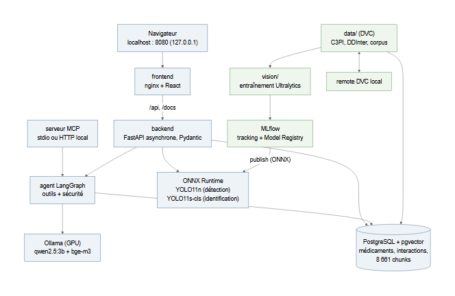
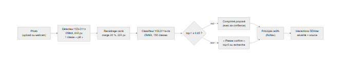
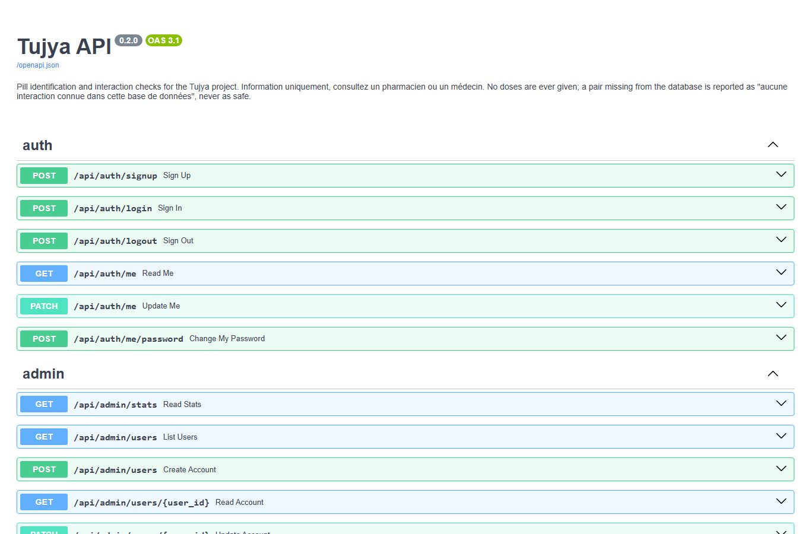
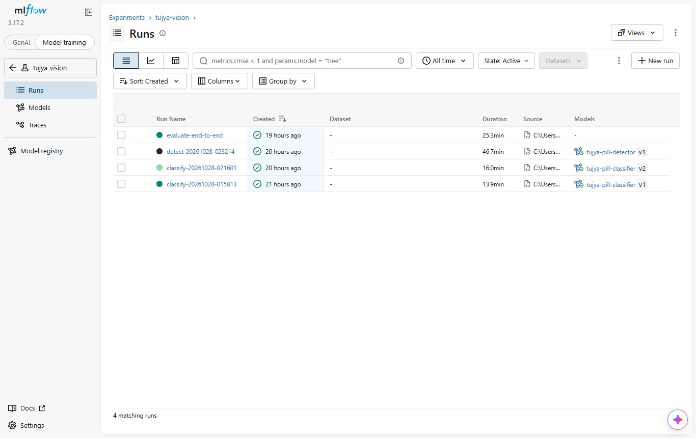
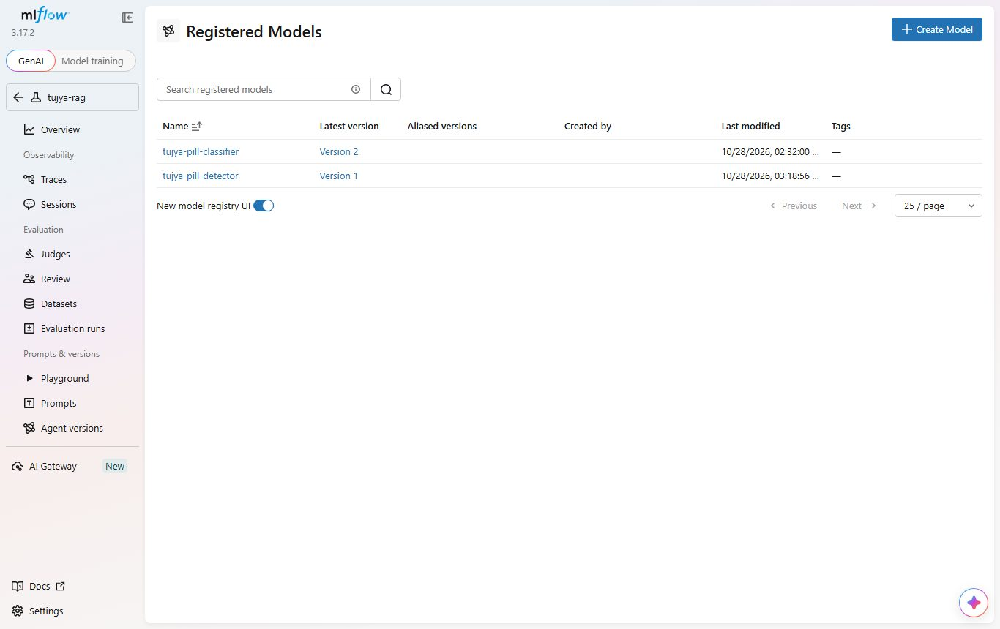
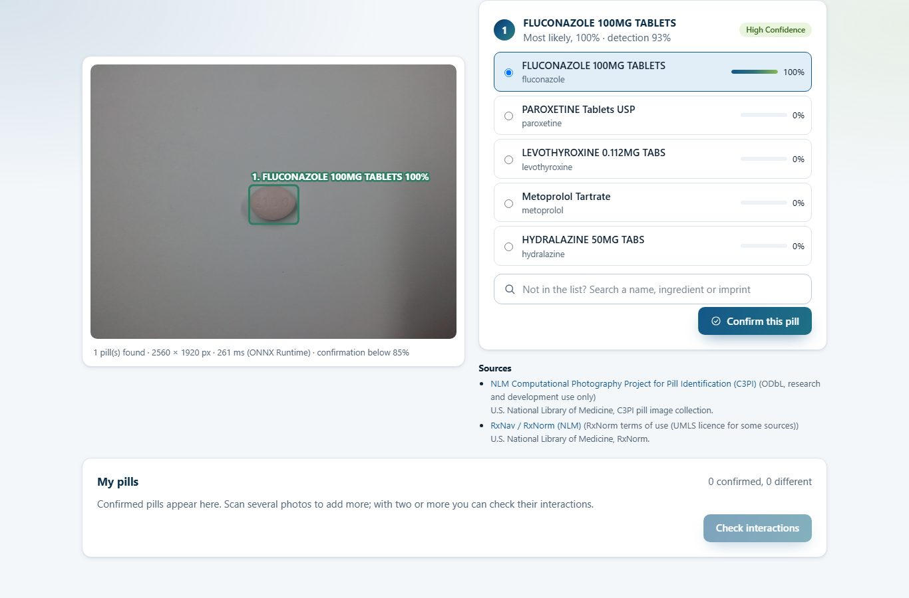
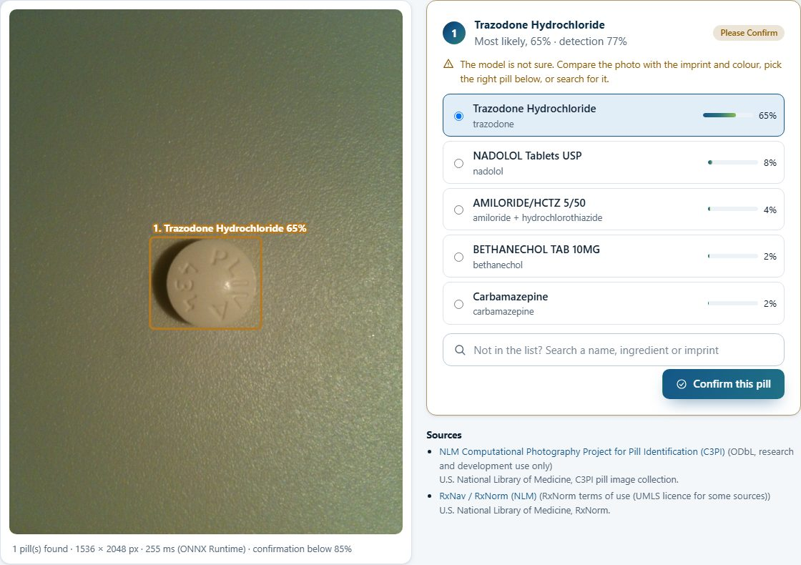
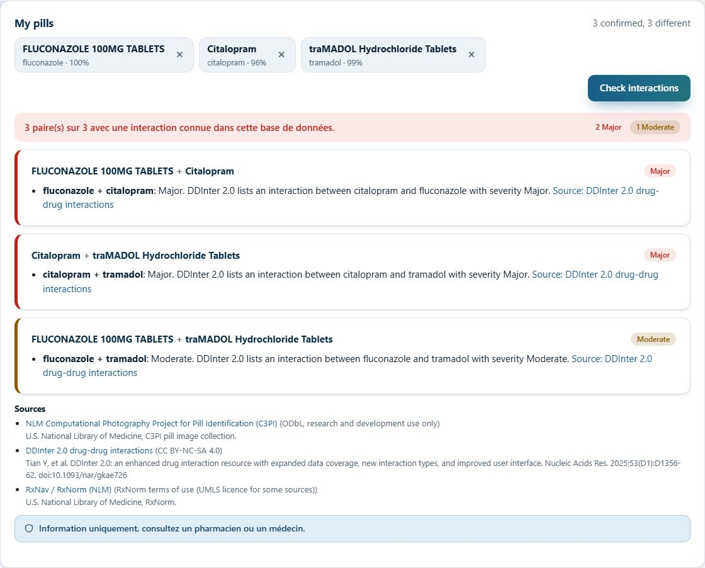
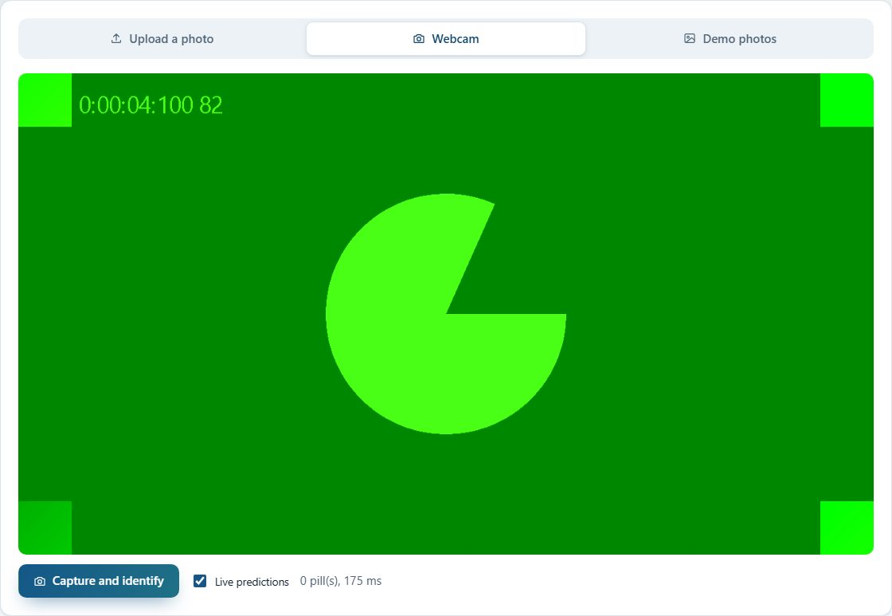

# Tujya : rapport technique du module 1, Industrialisation Vision & MLOps

Projet étudiant solo. Dépôt : <https://github.com/melekbouabid/tujia-> (code et
documentation ; données et modèles hors de git). Rapport rédigé le 2026-10-28 ; tous les
chiffres viennent des documents du dépôt (docs/VISION.md, docs/API.md, docs/INFRA.md,
docs/CD.md) et des runs MLflow ; aucun n'est estimé.

> Tujya est un outil d'information : il ne remplace pas un pharmacien ou un médecin, ne
> donne jamais de dose et ne dit jamais qu'une association est « sûre ».
> Information uniquement, consultez un pharmacien ou un médecin.

## 1. Contexte et objectif

Une personne qui prend plusieurs médicaments ne sait pas toujours reconnaître un comprimé
sorti de sa boîte, ni savoir si deux médicaments interagissent. Tujya répond à ce besoin en
trois temps : **scanner** une photo (upload ou webcam) pour **détecter** chaque comprimé et
l'**identifier** parmi une liste fermée de 150 comprimés ; relier chaque comprimé à ses
principes actifs ; **vérifier les interactions** dans la base DDInter. Le module 2 (rapport
séparé) ajoute un agent qui répond aux questions en citant ses sources.

Exigences du module 1 et où elles sont traitées :

| Exigence | Réalisation | Section |
|---|---|---|
| Détection YOLOv8/v11 | YOLO11n, 1 classe « pill » | 3.1 |
| Identification par transfer learning | YOLO11s-cls, 150 classes | 3.2 |
| API FastAPI asynchrone, Pydantic, Swagger `/docs` | `POST /api/scan`, `/api/interactions`, `/api/pills` | 4 |
| React : upload, webcam, prédictions et boîtes | page Scanner | 6 |
| DVC | données, étapes, remote | 5.1 |
| MLflow tracking + Model Registry | expérience `tujya-vision`, 2 modèles enregistrés | 5.2 |
| ONNX + ONNX Runtime | export vérifié, inférence sans PyTorch | 4.1 |
| Docker Compose | 7 services, une commande | 5.3 |
| GitHub Actions CI/CD | 4 jobs de CI, CD de build et test des images | 5.4 |

## 2. Données

### 2.1 Jeu de données C3PI

Les images viennent du jeu public de la NLM **C3PI** (Computational Photography Project for
Pill Identification), licence ODbL, usage recherche et développement. Aucune photo
personnelle n'est utilisée (règle du projet). L'exploration (docs/DATASET_C3PI.md) a
recensé 133 458 fichiers, dont **40 587 photos « consumer »** (prises avec des téléphones et
appareils variés) de 2 400 comprimés ; 380 comprimés ont au moins 20 photos. C3PI ne fournit
**aucune boîte englobante** pour ces photos.

### 2.2 Sous-ensemble retenu

- **150 classes** (une classe = un produit, NDC9 + partie) : les comprimés avec le plus de
  photos consumer, hors appareils Canon G10 et Nikon S3000 (images trop lourdes pour le
  débit de téléchargement) ; liste dans `config/pill_classes.csv`.
- Jusqu'à **30 photos par classe**, plus une image de référence RxNav par NDC :
  **4 206 fichiers, 4,8 Go**, téléchargés avec vérification SHA-1 (0 échec).
- **Split par photo 70/15/15**, stratifié par classe : **3 006 train / 600 val / 600 test** ;
  une photo et tous ses recadrages restent dans le même split.
- Chaque classe est reliée à ses principes actifs par RxNav (NDC -> RxCUI -> ingrédients de
  base, sans dosage) : 149/150 classes (la multivitamine n'a pas d'ingrédient unique), soit
  **82 principes actifs**, tous trouvés dans DDInter (2 350 paires entre classes : 125
  Major, 826 Moderate, 72 Minor, 1 327 Unknown).

### 2.3 Étiquetage automatique et audit

Sans boîtes dans C3PI, trois options ont été étudiées (D38) : annotations existantes (aucune
pour ces photos), jeu de détection public (licences floues, autres images), ou **étiquetage
automatique** des photos consumer, retenu car chaque photo montre un ou deux comprimés sur un
fond assez uni. `vision/tujya_vision/autolabel.py` : surface de fond quadratique robuste dans
l'espace Lab (absorbe le vignettage), distance de couleur avec ombres atténuées, régions
connexes ne touchant pas le bord, rejet des pièces de monnaie (référence de taille de C3PI),
correction par GrabCut des régions en croissant (ombre à côté d'un comprimé pâle). Chaque
photo reçoit des drapeaux ; une photo douteuse est exclue des deux jeux.

| Résultat de l'étiquetage | Photos |
|---|---:|
| Photos consumer | 4 056 |
| Propres (utilisées) | 3 306 (81,5 %) |
| Région irrégulière (ombre, demi-comprimé) | 462 |
| Aucune région (comprimé de la couleur du fond, granit) | 346 |
| Autres drapeaux douteux | 73 |
| Corrigées par GrabCut (gardées) | 311 |

**Audit à l'œil** d'une planche de 48 photos tirées au hasard : 40 passaient les filtres,
dont **36 avec toutes les boîtes justes (environ 90 %)**. Les erreurs : surtout un rectangle
de lumière inégale au bas d'un papier beige, et une fois un second comprimé manqué.

Jeux produits par l'étape DVC `prepare` : identification 2 962 / 562 / 589 recadrages de
224 px (train / val / test ; 148 classes en test, deux classes n'ayant aucune photo de test
propre) ; détection 2 345 / 478 / 483 photos (côté long 640 px).

## 3. Modèles

### 3.1 Détecteur

YOLO11n (Ultralytics), une classe « pill », affiné depuis les poids COCO, 640 px, batch 8,
**30 époques** sur la RTX 2050 (4 Go) ; augmentation mosaïque d'Ultralytics pour les scènes à
plusieurs comprimés.

| Test (483 photos) | mAP50 | mAP50-95 | Précision | Rappel |
|---|---:|---:|---:|---:|
| YOLO11n | **0,972** | **0,861** | 0,957 | 0,936 |

Ces chiffres mesurent l'**accord avec l'étiqueteur automatique** (lui-même juste à ~90 %),
pas avec une vérité humaine. Run MLflow `5c6db57a…`, enregistré `tujya-pill-detector` v1.

### 3.2 Classifieur (transfer learning)

YOLO11s-cls affiné depuis les poids ImageNet, recadrages de 224 px, **40 époques** sur GPU
(14 min). Un essai de contrôle de la chaîne sur CPU (YOLO11n-cls, 3 époques) donnait 19,4 % de
top-1.

| Test (589 recadrages, 148 classes) | Top-1 | Top-5 |
|---|---:|---:|
| Essai CPU, YOLO11n-cls, 3 époques | 19,4 % | 36,0 % |
| **YOLO11s-cls, 40 époques (GPU)** | **93,5 %** | **98,1 %** |

Validation à la dernière époque : top-1 92,2 %, top-5 97,9 %. Run MLflow `7d2ce0ff…`,
enregistré `tujya-pill-classifier` v2 (la v1 est l'essai CPU).

### 3.3 Bout en bout

`python -m tujya_vision.evaluate` sur **les 600 photos de test** (y compris les 117 rejetées
par l'étiqueteur), avec les deux exports ONNX : le détecteur tourne sur la photo entière, la
boîte la plus sûre est recadrée et classée.

| Photos | Comprimé détecté | Top-1 | Top-5 |
|---:|---:|---:|---:|
| 600 | 98,5 % | **89,2 %** | **95,8 %** |

Le pipeline réimplémenté dans l'API (section 4) donne **89,3 %** et **95,8 %** sur les
mêmes photos.

### 3.4 Seuil de confirmation

L'identification reste une suggestion : sous un seuil de probabilité top-1, l'application
demande une confirmation (top-5 ou recherche). Le seuil est choisi sur la **validation**
(jamais sur le test) : le plus bas pour lequel au plus 1 % des photos seraient acceptées avec
un mauvais comprimé (D47).

| Seuil | Acceptées sans confirmation | Top-1 parmi les acceptées | Fausses et acceptées |
|---:|---:|---:|---:|
| 0,5 | 87,2 % | 91,2 % | 7,7 % |
| 0,7 | 77,7 % | 95,3 % | 3,7 % |
| 0,8 | 71,7 % | 97,7 % | 1,7 % |
| **0,85** | **67,2 %** | **98,5 %** | **1,0 %** |
| 0,9 | 60,3 % | 98,9 % | 0,7 % |

Sur le **test**, au seuil 0,85 : **70,5 %** des photos acceptées sans confirmation, **99,3 %**
d'entre elles justes, 0,5 % de toutes les photos acceptées avec un mauvais comprimé.

## 4. Service des modèles

### 4.1 ONNX et ONNX Runtime

Chaque entraînement exporte `best.onnx`, vérifie ONNX Runtime contre PyTorch sur des images
de test, puis enregistre le **modèle ONNX** dans le Model Registry :

- classifieur : top-1 identique sur 100 % des recadrages vérifiés, écart de probabilité
  maximal 1,6e-6 ;
- détecteur : même nombre de boîtes sur 100 % de 50 photos de test, IoU moyen 0,976.

Le backend n'embarque **ni PyTorch ni Ultralytics** (D45) : `backend/app/scanner.py`
réécrit le letterbox, la NMS et le recadrage avec marge de 20 % en numpy/OpenCV et exécute
les deux fichiers ONNX avec ONNX Runtime (CPU). Contrôle contre le prédicteur ONNX
d'Ultralytics sur 40 photos de test : même nombre de boîtes 40/40, IoU moyen de la boîte
principale 0,9999, même top-1 39/39. Temps : **≈ 50 à 220 ms par photo** (décodage,
détection, identification), après avoir désactivé l'attente active des threads d'ONNX
Runtime, qui rendait le processus environ 30 fois plus lent (D49).

`python -m tujya_vision.publish` copie les versions du Model Registry (classifieur v2,
détecteur v1) dans `models/`, monté en lecture seule dans le conteneur ; chaque réponse de
scan renvoie les versions servies.

### 4.2 API FastAPI

| Route | Rôle |
|---|---|
| `POST /api/scan` | image (JPEG/PNG/WebP, 10 Mo, 50 Mpx max) -> boîtes (pixels et normalisées), top-5 (classe, nom, générique, principes actifs, probabilité), `needs_confirmation`, temps, versions des modèles, sources, avertissement |
| `POST /api/interactions` | 2 à 10 comprimés et/ou principes actifs -> chaque paire avec la sévérité DDInter, la description, la source ; sinon « Aucune interaction connue dans cette base de données » |
| `GET /api/pills?q=` | recherche dans les 150 classes (nom, générique, empreinte, fabricant, principe actif) pour la confirmation |
| `GET /api/demo/images` | 8 photos du split de test pour la galerie de démo (lecture seule) |
| `/docs`, `/openapi.json` | Swagger UI et schéma OpenAPI (« Tujya API ») |

Routes asynchrones, schémas Pydantic, connexion requise (cookie de session, D46). Tests :
113 tests backend au total (dont 12 pour le scan avec de petits modèles ONNX factices
construits dans le test, 16 pour les interactions, jamais le mot « safe »/« sûr »).

## 5. MLOps

### 5.1 DVC

Suivis par DVC (jamais par git) : images et métadonnées C3PI (`dvc add`), tables DDInter
(`data/tujya`), corpus RAG brut et intermédiaire, et les sorties de deux étapes de
`dvc.yaml` : `prepare` (étiquettes automatiques, jeux YOLO) et `rag_corpus` (chunks).
`dvc.lock` fixe les empreintes. **Remote** par défaut : un dossier local hors du dépôt
(`localstore`, D71) ; `dvc push` : **15 306 fichiers, 5,0 Go**. Preuve : clone neuf depuis
GitHub, `dvc pull` (15 306 fichiers en 10 min 54), `dvc status` à jour, et comparaison SHA-256
fichier par fichier avec l'original : **tous identiques** (seuls 5 caches Ultralytics,
exclus par `.dvcignore`, ne sont pas suivis). Passage à Google Drive ou S3 documenté dans
docs/INFRA.md (non configuré).

### 5.2 MLflow : tracking et Model Registry

Serveur MLflow 3.17.2 dans le compose, métadonnées dans PostgreSQL, artefacts dans un volume.
Chaque run de `tujya-vision` enregistre paramètres, matériel, nombres d'images, métriques
par époque, métriques de test, graphiques, poids et export ONNX. Registre :
`tujya-pill-classifier` (v1 essai CPU, **v2 servie**) et `tujya-pill-detector` (**v1
servie**).

### 5.3 Docker Compose

Une commande, `docker compose up -d --build`, démarre : `postgres` (pgvector),
`mlflow`, `pharma-init` (recharge les tables de médicaments puis s'arrête), `rag-init`
(module 2), `backend` (FastAPI + ONNX Runtime, utilisateur non root, healthcheck),
`ollama` (module 2, GPU) et `frontend` (nginx 1.27 qui sert le build React et transmet
`/api`, `/docs`, `/openapi.json`). Les images ne contiennent ni données ni modèles :
`config/`, `data/` et `models/` sont montés en lecture seule (D55). Test de fumée : santé,
Swagger, `/openapi.json` (18 routes à l'époque), scan réel d'une photo de test
(fluconazole, 0,996, 59 ms), interactions Major.

### 5.4 GitHub Actions CI/CD

- **CI** (`ci.yml`, chaque push et pull request) : 4 jobs : pipeline de données (ruff,
  format, mypy, 287 tests unitaires), backend (ruff, format, 113 tests, avec un service
  PostgreSQL + pgvector), vision (ruff, format, 14 tests sans entraînement), frontend
  (`npm ci`, vérification de types, build). Aucun appel réseau réel.
- **CD** (`cd.yml`, après une CI verte sur `main`) : construction des images backend et
  frontend du commit testé et **test de fumée** des conteneurs (santé, `/docs`, routes
  `/api/scan` et `/api/chat` ; site et route `/scan`). Depuis le 2026-10-28 la CD **ne
  publie plus les images** (D70) : l'application ne doit tourner que sur ce PC (section 7).
  La publication sur ghcr.io n'existe plus qu'en option manuelle, désactivée par défaut.
  Runs vérifiés avec `gh` : CI 40768873414 et CD 40769096658 verts, job `publish` ignoré.

## 6. Application web

Page **Scanner** de l'application React (Vite, TypeScript) : upload par glisser-déposer,
**webcam** (prédictions en direct environ chaque seconde, capture), galerie de 8 photos du
split de test ; boîtes et étiquettes en SVG sur la photo ; top-5 avec barres de probabilité ;
badge « Please confirm » sous 0,85 avec recherche d'un autre comprimé ; liste « My pills » ;
interactions par sévérité avec source, citation et avertissement. Le parcours est vérifié
par des scripts Playwright sur les conteneurs (docs/DEMO.md).

## 7. Déploiement strictement local

Choix du projet (D69) : Tujya tourne **uniquement sur ce PC**. Pas de déploiement public,
pas de tunnel, pas d'image publiée, aucun service sur `0.0.0.0` côté machine ; le dépôt
GitHub reste public pour le code et la documentation. Raisons : données de santé, licences
des données (DDInter non commerciale, C3PI recherche), aucun coût d'hébergement.

- Tous les ports du compose sont publiés sur `127.0.0.1` ; Vite et le serveur MCP HTTP
  n'écoutent que sur la boucle locale (option `--host` limitée et testée).
- Vérifié avec `netstat` : les 5 ports (5432, 5000, 8000, 8080, 11434) uniquement sur
  `127.0.0.1` ; connexion refusée depuis les adresses réseau du PC.
- Conséquence trouvée en répétant la démo (D72) : `localhost` est résolu d'abord en IPv6
  `::1` ; les outils Python côté PC se connectent donc à `127.0.0.1` (sinon 65 à 100 s
  d'attente par connexion PostgreSQL).

## 8. Limites et suite

- **Boîtes automatiques** : le mAP du détecteur mesure l'accord avec l'étiqueteur (~90 %
  juste sur l'audit), pas une vérité humaine. Suite : vérifier à la main les boîtes du test,
  deuxième passe d'étiquetage avec le détecteur entraîné.
- **Split par photo** : le test contient d'autres photos des mêmes comprimés physiques ; les
  scores sont optimistes. Suite : test sur d'autres exemplaires et de vraies photos de webcam
  (seule la caméra factice a été testée).
- **Liste fermée** de 150 classes : un comprimé hors liste reçoit quand même une classe ;
  le seuil 0,85 et la confirmation limitent le risque sans le supprimer.
- **Pas de comparaison avec ePillID** (problème plus dur, autres métriques) : à faire sur
  son split.
- Swagger UI charge ses fichiers depuis un CDN : sans Internet, `/docs` est vide.
- Remote DVC sur le même disque que le dépôt : ce n'est pas une sauvegarde.
- Interface en anglais, textes de sécurité en français (D53).

## 9. Références

- NLM C3PI : <https://catalog.data.gov/dataset/computational-photography-project-for-pill-identification-c3pi>, fichiers <https://data.lhncbc.nlm.nih.gov/public/Pills/> (ODbL).
- N. Usuyama, N. L. Delgado, A. K. Hall, J. Lundin, « ePillID Dataset: A Low-Shot
  Fine-Grained Benchmark for Pill Identification », CVPR Workshops 2020, arXiv:2005.14288.
- Ultralytics YOLO11 : <https://docs.ultralytics.com/>.
- ONNX Runtime : <https://onnxruntime.ai/>.
- DDInter 2.0 : <https://ddinter2.scbdd.com/> (CC BY-NC-SA 4.0).
- RxNorm / RxNav (NLM) : <https://lhncbc.nlm.nih.gov/RxNav/APIs/>.
- FastAPI <https://fastapi.tiangolo.com/>, MLflow <https://mlflow.org/>, DVC
  <https://dvc.org/>, Docker Compose, GitHub Actions.
- Documents du dépôt : docs/VISION.md, docs/DATASET_C3PI.md, docs/API.md, docs/INFRA.md,
  docs/CD.md, docs/DECISIONS.md (D38 à D72), docs/DEMO.md.
