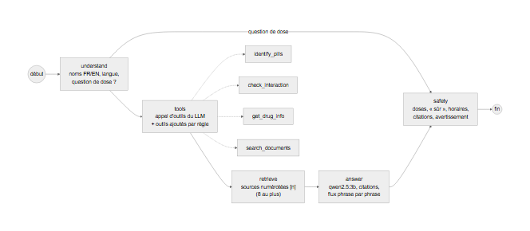
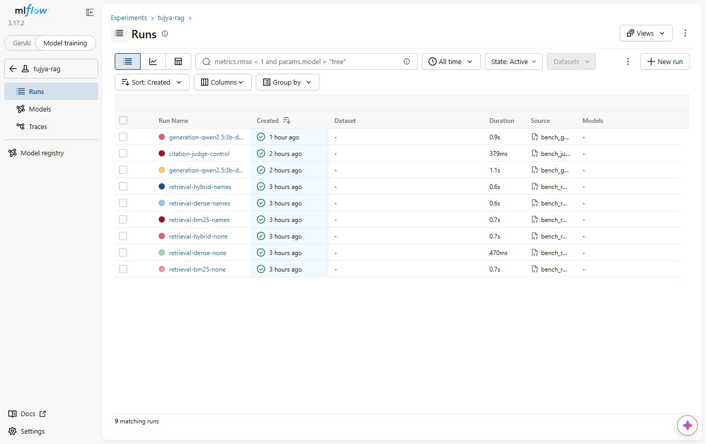
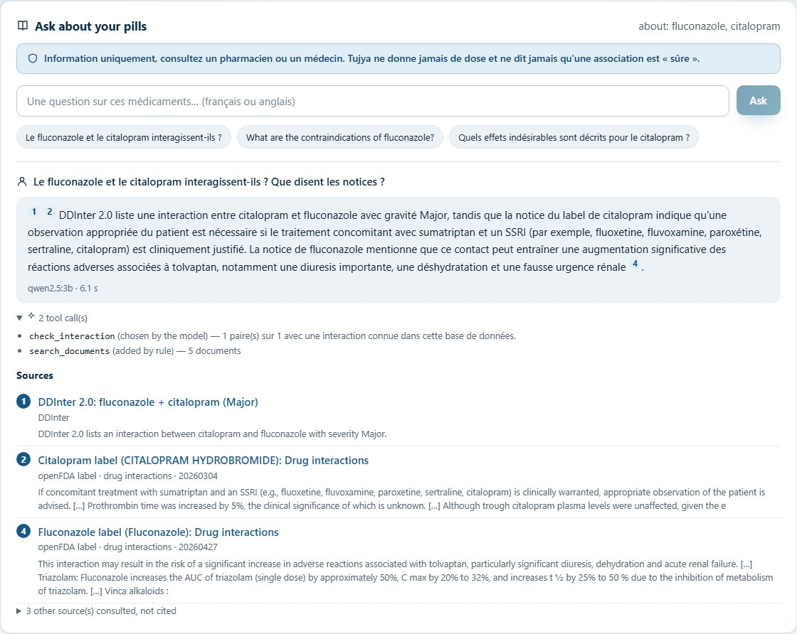
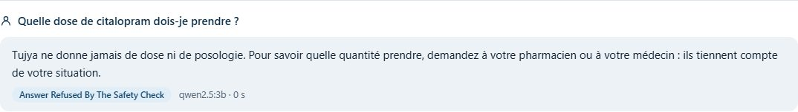

# Tujya : rapport technique du module 2, AI Engineering

Projet étudiant solo. Dépôt : <https://github.com/melekbouabid/tujia-> (code, documentation
et historique des commits ; données hors de git). Rapport rédigé le 2026-10-28 ; tous les
chiffres viennent des documents du dépôt (docs/RAG.md, docs/AGENT.md, docs/MCP.md,
docs/BENCHMARK.md) et des runs MLflow de l'expérience `tujya-rag` ; aucun n'est estimé.

> Tujya ne donne jamais de dose, ne dit jamais qu'une association est « sûre » (au mieux
> « aucune interaction connue dans cette base de données ») et cite toujours ses sources.
> Information uniquement, consultez un pharmacien ou un médecin.

## 1. Contexte

Le module 1 identifie des comprimés sur une photo et vérifie leurs interactions dans
DDInter. Le module 2 permet de **poser des questions de suivi** (« Le fluconazole et le
citalopram interagissent-ils ? », « Quelles sont les contre-indications de la metformine ? »)
et d'obtenir une réponse **fondée uniquement sur des documents cités**, avec des règles de
sécurité médicales appliquées dans le code.

| Exigence du module 2 | Réalisation | Section |
|---|---|---|
| RAG : gestion des documents, métadonnées, citations, documentation | corpus de 8 661 chunks, 18 colonnes de métadonnées, citations [n] | 2, 3 |
| Tool calling / MCP | 4 outils appelés par le LLM ; serveur MCP officiel | 4, 5 |
| LangChain / LangGraph | graphe LangGraph à 5 nœuds, outils LangChain | 4 |
| Benchmark de la récupération et de la génération | 88 questions, Recall@k / MRR, sécurité, citations, RAGAS | 7 |
| Interface web | panneau de chat sur la page Scanner | 8 |
| Dépôt documenté, commits réguliers | docs/, journal du README, historique git | — |

## 2. Corpus et métadonnées

Le corpus porte sur les **82 principes actifs** des 150 classes de comprimés.

| Type | Source | Licence | Documents | Chunks |
|---|---|---|---:|---:|
| `label` | notices openFDA (SPL) | CC0 / domaine public | 82 (une par principe actif) | 2 895 |
| `abstract` | résumés PubMed (E-utilities) | conditions NLM | 1 570 | 3 416 |
| `interaction` | DDInter 2.0, paires entre les 82 principes actifs | CC BY-NC-SA 4.0 | 2 350 | 2 350 |
| **Total** | | | **4 002** | **8 661** |

- **Notices openFDA** : nouveau connecteur `openfda_label` dans le style du pipeline existant
  (client poli à 3 requêtes/s, cache HTTP, manifeste SHA-256, provenance). Une notice par
  principe actif selon une **règle fixe et auditable** (D60) : la notice concerne bien le
  principe actif, mono-principe actif avant association, sur ordonnance avant OTC, le plus de
  sections utiles, la plus récente. Résultat : 82/82 (81 sur ordonnance, 1 OTC), dates de
  2021-09-30 à 2026-09-11. Les 25 candidates sont gardées avec la notice choisie.
- **PubMed** : mode `ingredients` du connecteur existant : interactions ou effets
  indésirables, résumés en anglais depuis 2000, tri par pertinence, **20 au plus par principe
  actif** (D61) : 1 570 articles distincts (17 à 20 par principe actif), dont **4 rétractés**,
  gardés avec `is_retracted = true` et exclus de la recherche par défaut.
- **DDInter** : une ligne par paire ; « Unknown » est écrit « interaction dont DDInter ne
  donne pas la sévérité », jamais « pas d'interaction ». Les 40 508 paires avec n'importe quel
  médicament restent hors de l'index texte mais sont lues par l'outil `check_interaction`
  (D62).
- **Métadonnées** (une ligne par chunk, `chunks.parquet`) : `chunk_id` stable (hash),
  `doc_id`, `doc_type`, `ingredients`, `mentioned_ingredients`, `section`, `chunk_index`,
  `title`, `text`, `source_name`, `url` (DailyMed, PubMed, DDInter), `date`, `version`,
  `license`, `article_type`, `is_retracted`, `language`, `retrieved_at`.
- **Versionnement** : `data/rag/raw`, `interim` et le manifeste par `dvc add` ; les chunks par
  l'étape `rag_corpus` de `dvc.yaml` ; tout est poussé sur le remote DVC (15 306 fichiers au
  total avec les images).

## 3. Découpage et exclusions de sécurité

- **Notices : par section**, 1 500 caractères au plus, coupées sur les fins de phrase avec
  une phrase de chevauchement. **Résumés : par paragraphe** (BACKGROUND, RESULTS…).
  **DDInter : une ligne par paire.** Chaque chunk a un titre de contexte (« Fluconazole label
  (Diflucan): Drug interactions ») indexé avec le texte. Longueur moyenne 687 caractères.
- **Exclusions** : les sections `dosage_and_administration`, `dosage_forms_and_strengths`,
  `overdosage`, `how_supplied`, emballage, pharmacocinétique et études cliniques sont
  **retirées avant l'écriture** du fichier brut, refusées par le schéma Pydantic et par le
  découpeur (tests dédiés). Limite : d'autres sections citent des quantités (1 010 chunks
  contiennent « <nombre> mg ») ; c'est le nœud de sécurité de l'agent qui retire toute phrase
  de réponse avec une dose, et l'interface masque ces phrases dans les extraits affichés.

## 4. Récupération

- **Embeddings bge-m3** (multilingue, 1 024 dimensions) servis par Ollama (D59), 0,7 Go de
  VRAM, compatible avec le LLM sur le même GPU. Une phrase française et sa traduction
  anglaise : cosinus 0,87 ; une phrase sans rapport : 0,53.
- **Stockage** : table `rag_chunks` dans PostgreSQL + **pgvector** (`vector(1024)`),
  métadonnées en colonnes, listes de principes actifs en `text[]`. Indexation idempotente
  (`python -m app.rag.index`) : 8 661 chunks en **364 s** sur la RTX 2050 ; deuxième passage :
  0 recalculé en 0,1 s.
- **Trois modes** : **BM25** (en mémoire, ≈ 6 ms), **dense** (cosinus exact en SQL,
  130-190 ms, surtout l'embedding de la question), **hybride** RRF k = 60 (≈ 170 ms).
  Filtres : principe actif (sujet ou cité), type de document, section, articles rétractés
  exclus par défaut. Pas d'index HNSW : à cette taille, la recherche exacte suffit.
- **Choix mesuré** (section 7) : **dense + filtre de principe actif** par défaut (D65).

## 5. Agent LangGraph

| Nœud | Rôle | LLM |
|---|---|---|
| `understand` | noms de médicaments en français ou en anglais (« warfarine » -> warfarin), comprimés confirmés, langue, question de dose ? | non |
| `tools` | le LLM choisit les appels (appel d'outils d'Ollama) ; le graphe ajoute ceux qui manquent : `check_interaction` pour deux médicaments ou plus, `search_documents` toujours (D64) ; chaque appel est marqué `llm` ou `rule` | oui |
| `retrieve` | sources numérotées [1], [2]… : DDInter d'abord, puis extraits de notice, puis résultats de recherche ; 8 au plus | non |
| `answer` | réponse à partir des sources seulement, citations [n], en flux phrase par phrase | oui |
| `safety` | règles de sécurité sur toute la réponse : réécriture ou refus | non |

**Outils** (outils LangChain, mêmes fonctions que le serveur MCP) : `identify_pills` (la
logique de `/api/scan`), `check_interaction` (celle de `/api/interactions`), `get_drug_info`
(classes de comprimés et extraits de notice), `search_documents` (recherche avec filtres).
Ajouter un outil = une méthode de `Toolbox` et une entrée de `TOOL_SPECS`.

**Nœud de sécurité** (règles en code, D63) :

1. **Pas de dose** : une question de dose est refusée **avant tout appel au LLM** ; une
   phrase avec une quantité de médicament (« 50 mg », « deux fois par jour ») ou un conseil
   d'ajustement de dose est retirée ; les valeurs biologiques (« eGFR 30 mL/min ») ne sont
   pas des doses.
2. **Jamais « sûr »** : une phrase « sûr / sans danger / safe » est retirée, et remplacée par
   « Aucune interaction connue dans cette base de données. » si rien n'est trouvé.
3. **Pas d'horaire inventé** : un conseil d'intervalle ou de repas n'est gardé que s'il cite
   une source.
4. **Citations** : `[n]` doit pointer vers une source ; une phrase sans citation est
   rattachée à la source qui contient au moins 60 % de ses mots, ou par le sens (bge-m3,
   D68) ; sans aucune source, pas de réponse.
5. **Avertissement** : chaque réponse se termine par « Information uniquement, consultez un
   pharmacien ou un médecin. »

En flux, une phrase interdite n'est jamais affichée. `POST /api/chat` (asynchrone, connexion
requise) renvoie la réponse, les citations (titre, URL, section, extrait, `cited`), les
appels d'outils, le résultat du contrôle de sécurité et les temps ; avec `stream: true`,
des événements SSE `tool`, `token`, `final`.

## 6. Serveur MCP et LLM local

- **MCP** : `backend/app/mcp_server.py`, SDK Python officiel (`mcp` 2.3), les **4 mêmes
  outils** (même code), consignes de sécurité dans les `instructions` du serveur ;
  transports stdio et streamable HTTP (limité à `127.0.0.1`). Test de fumée réel
  (`scripts/mcp_smoke.py`, ≈ 11 s) : 4 outils listés, warfarine + fluconazole -> Major,
  « metformin lactic acidosis » -> notices de la metformine. 3 tests (liste et schémas,
  appels, refus d'une adresse non locale).
- **Choix du LLM** (D58), sur une RTX 2050 de 4 Go, même question courte en français :

| Modèle | VRAM | Placement | Vitesse | Temps de réponse |
|---|---:|---|---:|---:|
| **qwen2.5:3b** | 2,2 Go | 100 % GPU | 47,4 jetons/s | **1,7 s** |
| llama3.2:3b | 2,9 Go | 80 % GPU | 32,0 jetons/s | 3,2 s |
| gemma3:4b | 2,9 Go | 55 % GPU | 11,8 jetons/s | 12,1 s |
| qwen3:4b | 2,9 Go | 82 % GPU | 14,0 jetons/s | 89,9 s |

  qwen2.5:3b est le seul entièrement sur le GPU, le plus rapide, avec un bon français et
  l'appel d'outils. Réglages trouvés par le benchmark (D68) : contexte 4 096 jetons (avec
  8 192, le LLM et bge-m3 ne tenaient plus ensemble sur le GPU) et 450 jetons de réponse au
  plus (une réponse avait bouclé sur plus de 24 000 jetons).

## 7. Benchmark

### 7.1 Jeu de questions

**88 questions** (44 FR, 44 EN) sur les 82 principes actifs : 24 interactions, 12
contre-indications, 10 encadrés, 10 mécanismes, 10 effets indésirables, 8 mises en garde,
9 constats d'articles PubMed, 5 questions pièges (2 doses, 2 « est-ce sûr », 1 horaire).
Construites par règles à partir du corpus (chunks attendus, référence extraite), puis
**relues à la main** (D66) : grammaire corrigée, 2 questions remplacées, 14 références
d'interaction et 9 références d'articles réécrites, aucune référence avec une dose.

### 7.2 Récupération (83 questions avec chunks attendus, top 10)

| Mode | Filtre | Recall@1 | Recall@3 | Recall@5 | Recall@10 | MRR |
|---|---|---:|---:|---:|---:|---:|
| BM25 | aucun | 0,554 | 0,711 | 0,735 | 0,783 | 0,637 |
| dense (bge-m3) | aucun | 0,783 | 0,867 | 0,904 | 0,976 | 0,841 |
| hybride (RRF) | aucun | 0,699 | 0,855 | 0,892 | 0,940 | 0,779 |
| BM25 | principe actif | 0,566 | 0,747 | 0,783 | 0,819 | 0,660 |
| **dense** | **principe actif** | **0,795** | **0,880** | **0,928** | **0,976** | **0,852** |
| hybride | principe actif | 0,711 | 0,892 | 0,904 | 0,928 | 0,796 |

**BM25 contre dense** : le corpus est en anglais ; BM25 échoue sur les questions françaises
(Recall@5 0,585 contre 0,976 en anglais) et tire l'hybride vers le bas. En anglais seul,
l'hybride est légèrement meilleur (MRR 0,944 contre 0,937). Le dense filtré devient le
réglage par défaut ; une traduction de la requête pour BM25 n'a pas été tentée, pour ne pas
ajuster le système à son propre jeu de test.

### 7.3 Génération (agent réel sur les 88 questions ; juge gemma3:4b, D67)

| Contrôle | Résultat |
|---|---:|
| Avertissement en fin de réponse | 100 % |
| Phrases avec une dose chiffrée | 0 |
| Conseils d'ajustement de dose sans chiffre (règle étendue après ce run) | 4 |
| Phrases disant « sûr » / « safe » | 0 |
| Questions de dose refusées (avant tout appel au LLM) | 2 / 2 |
| Phrases de réponse avec une citation [n] | 69,8 % |
| **Phrases citées soutenues par leur source** (juge) | **94,0 %** (FR 90,0 %, EN 96,5 %) |
| Contrôle du juge : « oui » pour une source sans rapport | 10,0 % (4 / 40) |
| Temps de réponse (modèles chargés) | moyenne 4,7 s, médiane 4,5 s |

**RAGAS 0.4.3** sur un sous-ensemble de 8 questions (une par type) : fidélité **0,979**
(6/8 notées), précision du contexte **0,809** (8/8), pertinence de la réponse **non
calculable** (sorties du juge illisibles). Le juge local de 4B est bien plus faible que ceux
prévus par RAGAS : ces scores servent à comparer des runs de ce système.

Tous les runs sont dans MLflow (expérience `tujya-rag` : 6 runs de récupération, 2 de
génération, 1 de contrôle du juge).

## 8. Interface de chat

Panneau « Ask about your pills » sous la page Scanner : suggestions à partir des comprimés
confirmés, réponse en flux SSE phrase par phrase (déjà vérifiée), citations numérotées
cliquables vers la liste des sources (titre, type, section, date, extrait sans dose), appels
d'outils repliables, badge quand le contrôle de sécurité a modifié ou refusé la réponse,
avertissement toujours visible. Sur les conteneurs : réponse en **5,6 s** une fois les
modèles chargés (la toute première question après un démarrage a pris 83,9 s, d'où une étape
de préchauffage dans le script de démo).

![Après un clic sur [1] : la source surlignée.](../screenshots/10-chat-citation.jpg)

## 9. Limites et suite

- **Modèle de 3B** : réponses justes et citées pour les contre-indications, mécanismes,
  encadrés et sévérités DDInter, mais phrases hors sujet prises dans la même section de
  notice (fluconazole + citalopram : tolvaptan, triazolam), un détail inventé une fois, une
  liste de sources recopiée une fois ; 30 % des phrases sans citation. Un modèle de 7-8B ne
  tient pas dans 4 Go.
- **Benchmark** : questions sur modèle, construites et relues par la même personne ; un seul
  ensemble de chunks attendus (scores en borne basse) ; juge de 4B ; RAGAS sur 8 questions.
- **Sécurité par expressions régulières** (FR, EN) : une dose écrite autrement pourrait
  passer ; à l'inverse, des phrases sans danger sont parfois retirées.
- **BM25 en français** : pas de traduction de requête ; hybride non retenu.
- Suite : filtrer les phrases des sources qui ne parlent pas des médicaments de la question,
  un LLM plus grand sur un GPU plus gros, RAGAS sur tout le jeu avec un juge plus fort, un
  benchmark écrit par une autre personne, interface en français.

## 10. Références

- openFDA drug label API : <https://open.fda.gov/apis/drug/label/>.
- NCBI E-utilities (PubMed) : <https://www.ncbi.nlm.nih.gov/books/NBK25501/>.
- DDInter 2.0 : <https://ddinter2.scbdd.com/> (CC BY-NC-SA 4.0).
- J. Chen et al., « BGE M3-Embedding », arXiv:2402.03216 (bge-m3).
- Qwen2.5 (Alibaba) ; Ollama <https://ollama.com/>.
- LangGraph / LangChain <https://www.langchain.com/langgraph> ; Model Context Protocol
  <https://modelcontextprotocol.io/>.
- pgvector <https://github.com/pgvector/pgvector> ; S. Robertson, H. Zaragoza, « The
  Probabilistic Relevance Framework: BM25 and Beyond », 2009 ; G. Cormack et al.,
  « Reciprocal Rank Fusion », SIGIR 2009.
- S. Es et al., « RAGAS: Automated Evaluation of Retrieval Augmented Generation »,
  arXiv:2309.15217.
- Documents du dépôt : docs/RAG.md, docs/AGENT.md, docs/MCP.md, docs/BENCHMARK.md,
  docs/DECISIONS.md (D57 à D72), docs/DEMO.md.
